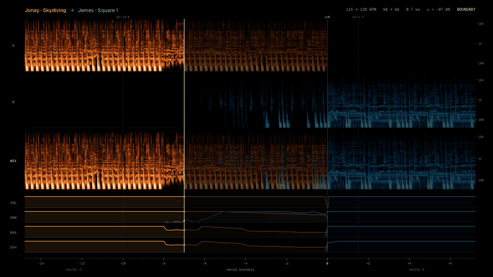
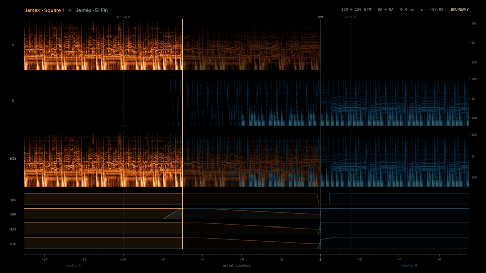
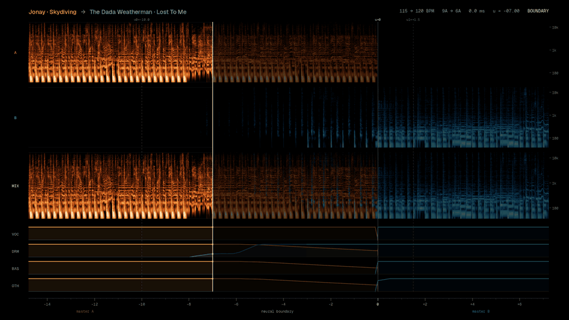
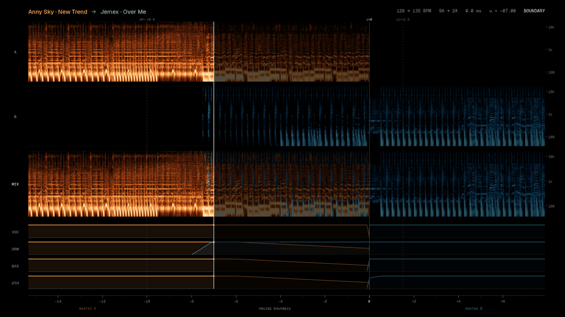

<p align="center"></p>

# Sone

**Sone** (named after Stevens' psychoacoustic *sone* unit of perceived loudness) is a four-tier family of neuro-symbolic automatic DJ transition and stem separation models (`6.5M` to `35.5M` parameters) that run on a single CPU thread or WebAssembly worker with no external ML runtime dependencies.

Instead of passing full songs through a generative audio codec, Sone separates, analyses, plans, and audits only a ~24 s boundary window around each track handoff. Four compact neural organs packaged inside one `model.safetensors` file predict stem masks, metrical structure, transition plans, and defect scores, while deterministic Rust DSP renders the blend and splices untouched studio master stereo bit-for-bit everywhere outside the transition.

**[Paper (PDF)](paper/main.pdf)** · [Model card](MODEL_CARD.md) · [Interactive demos](https://lukaloehr.com/sone/#demos) · [Blog post](https://lukaloehr.com/blog/sone/)

## Transition demos

Four end-to-end transitions rendered on Creative Commons vocal tracks ([CC BY-SA 3.0](https://creativecommons.org/licenses/by-sa/3.0/); full attribution in [assets/demos/CREDITS.md](assets/demos/CREDITS.md)). Each 60 fps render displays Deck A's isolated spectrum (copper), Deck B's tempo-locked spectrum (cyan), the dual-chrominance master output, and the four stem gain trajectories (`VOC`, `DRM`, `BAS`, `OTH`) across `master A`, the neural boundary `[u0, u1]`, and `master B`. Click any preview to play the 1080p60 video with audio:

| [Jonay · Skydiving](https://www.jamendo.com/track/354778) → [Jemex · Square 1](https://www.jamendo.com/track/135657) | [Jemex · Square 1](https://www.jamendo.com/track/135657) → [Jemex · El Fin](https://www.jamendo.com/track/135661) |
|---|---|
| [](https://lukaloehr.com/sone/demos/skydiving-into-square-1.mp4)<br>`115 → 120 BPM · 9A → 8A · 0.7 ms drift` · [Watch 1080p60 with audio ↗](https://lukaloehr.com/sone/demos/skydiving-into-square-1.mp4) · [MP4](assets/demos/skydiving-into-square-1.mp4) | [](https://lukaloehr.com/sone/demos/square-1-into-el-fin.mp4)<br>`120 → 120 BPM · 8A → 9A · 0.0 ms drift` · [Watch 1080p60 with audio ↗](https://lukaloehr.com/sone/demos/square-1-into-el-fin.mp4) · [MP4](assets/demos/square-1-into-el-fin.mp4) |
| **[Jonay · Skydiving](https://www.jamendo.com/track/354778) → [The Dada Weatherman · Lost To Me](https://www.jamendo.com/track/1194312)** | **[Anny Sky · New Trend](https://www.jamendo.com/track/1187965) → [Jemex · Over Me](https://www.jamendo.com/track/135660)** |
| [](https://lukaloehr.com/sone/demos/skydiving-into-lost-to-me.mp4)<br>`115 → 120 BPM · 9A → 6A · 0.0 ms drift` · [Watch 1080p60 with audio ↗](https://lukaloehr.com/sone/demos/skydiving-into-lost-to-me.mp4) · [MP4](assets/demos/skydiving-into-lost-to-me.mp4) | [](https://lukaloehr.com/sone/demos/new-trend-into-over-me.mp4)<br>`128 → 135 BPM · 9A → 2A · 0.0 ms drift` · [Watch 1080p60 with audio ↗](https://lukaloehr.com/sone/demos/new-trend-into-over-me.mp4) · [MP4](assets/demos/new-trend-into-over-me.mp4) |

## Results

Held-out MUSDB18-HQ (`n = 12`, 60 s stereo) separation SDR (dB), vocal-to-instrumental bleed, and single-threaded Intel Xeon CPU real-time factor (RTF) against the offline GPU teacher (`BS-RoFormer-1297`). All Cochlea variants enforce exact stereo mixture conservation (`< -148 dB`) and FP32-vs-FP16 waveform deviation `<= 2.39e-4`:

| Model (`cochlea.*`) | Vocals ↑ | Drums ↑ | Bass ↑ | Other ↑ | Mean SDR ↑ | Vocal leak ↓ | 1-vCPU RTF |
|---|---:|---:|---:|---:|---:|---:|---:|
| `Cochlea v1` (4.52 M, 2048-FFT, 42b) | 3.57 | 3.50 | 2.75 | 1.33 | 2.79 | -6.3 dB | 0.13x |
| `Cochlea-v2-Base` (11.61 M, 4096-FFT, 64b) | 6.73 | 6.06 | 4.23 | 2.60 | 4.90 | -9.3 dB | 0.40x |
| `Cochlea-Pro` (20.07 M, Stage-1) | 7.84 | 6.76 | 4.41 | 3.19 | 5.55 | -10.8 dB | 0.96x |
| `Cochlea-Pro v2` (20.07 M, +RoFormer-1297) | **7.98** | 6.99 | **4.63** | **3.31** | **5.73** | **-10.9 dB** | 0.96x |
| `Cochlea-Ultra` (29.18 M, 10B Net2Net) | 7.95 | **7.03** | 4.57 | 3.30 | 5.71 | -10.9 dB | 1.30x |
| *Teacher: `BS-RoFormer-1297`* | *12.98* | *–* | *–* | *–* | *–* | *-21.4 dB* | *GPU offline* |

Held-out planning, conflict monitoring (`val.jsonl.gz`, `n = 5,932` in v4), and 50 Hz structural perception (full tables and protocol in the paper):

| Organ | Held-out metric | Value | 1-vCPU latency |
|---|---|---|---:|
| `Tympanum-Pro` (1.47 M, equiv.) | Beat F1 / Downbeat F1 / Voice Acc / Tuning MAE | 0.862 / 0.506 / 82.3% / 6.41 c | 0.0085x RT |
| `Cortex v4-Pro` (3.60 M, 8L/192D) | Recipe Acc / Bar MAE / 8-Lane MAE | 98.16% / **0.127 bars** / **0.0157** | 38.0 ms |
| `Cingulate v4-Pro` (1.23 M, 30 heads) | Unseen Acc / Owner Precision (`n = 152`) | 96.61% / **100.0%** (FP = 0) | 16.7 ms (100 ms Best-of-6) |
| End-to-end rendered mixes (`n = 10`) | Beat drift / Vocal-handoff 1 s floor lift | `<= 0.7 ms` (0.28 ms mean) / **+10.55 dB** | 8.6 s to 65.5 s / mix |

Known weaknesses, all stated in the paper:

- When an outgoing song sings up to its final beat with no instrumental outro or breath pause, `Cortex` selects a hard on-beat cut or minimal sneak rather than causing a double-vocal clash. Turning such pairs into long blends requires upstream playlist ordering or bar-loop synthesis.
- Single-pass 6 s chunked CPU models narrow the gap to offline GPU separators, but heavily drenched stereo pop vocal reverb tails remain harder than for `>100M` full-song GPU RoPE ensembles.
- Global BSSEval SDR diverges toward `-inf dB` on instrumental boundary windows where ground-truth vocals are silent (`-108 dBFS`) even when residual vocal bleed is below `-77 dBFS`; DJ boundaries should be scored with MDX23 active-chunk median SDR plus silent-stem RMS floors.
- `Cortex` operates in a 4/4 bar grammar within `±6.8%` key-locked time-stretch and does not produce turntable scratch routines, stutter edits, or 3/4 meter blends.
- The 152 human-audited preference ratings (`owner.jsonl`) come from one station creator rather than a multi-listener MUSHRA panel. Out-of-sample neural generalisation is measured on strictly unseen `val.jsonl.gz` (`n = 5,932`).

## How it works

```text
Deck A master ─┐
               ├─► boundary window (~24 s) ─► Cochlea  (4096-FFT, 64-band 4-stem Wiener separator)
Deck B master ─┘                           ─► Tympanum (50 Hz 7-head sensor + multi-octave comb grid)
                                                    │
                                                    ▼
                                                Cortex   (Beat Transformer: recipe, bar offsets, 8 stem lanes)
                                                    │
                                                    ▼
                                                Cingulate (30-defect counterfactual monitor, Best-of-6)
                                                    │
                                                    ▼
                    untouched A ──► cosine seam ──► DSP blend + Newton lock ──► cosine seam ──► untouched B
```

| Component | Choice |
|---|---|
| `Cochlea` (`cochlea.*`) | 4096-FFT (10.77 Hz/bin), 64 vocal-formant subbands, Dual-Axis Time+Band Transformer (`6B/80D` Base, `8B/128D` Pro, `10B/160D` Net2Net Ultra), bounded 4-stem complex masks |
| Mixture conservation | Power-weighted complex Wiener projection + time-domain `other = mix - (vocals + drums + bass)`, exact to `< -148 dB` |
| `Tympanum` (`tympanum.*`) | 50 Hz HTK log-mel (`128` or `160` bins), dilated DWConv + BiGRU, 7 heads (beat, downbeat, voice, breath, 8-bar phrase, 24 keys, tuning cents), vinyl-speed equivariant training + spectral-flux comb grid |
| `Cortex` (`cortex.*`) | Pre-RMSNorm Beat Transformer on 209 tokens (`[global; A_80; B_128]`, 24 features/beat), predicting recipe, `(u_start, u_swap)`, and `80 x 8` stem gain curves with post-drop unity lock and pre-vocal silence gating |
| `Cingulate` (`cingulate.*`) | Conflict Transformer scoring acceptability `q in [0, 1]` and 30 DJ defect modes, trained with 50% vectorized 12-mode GPU counterfactual synthesis; reranks `K = 6` plans in 52 to 100 ms CPU |
| DSP & splicing | Pure Rust key-locked transient-preserving stretch, closed-form Newton drum-slope alignment, Linkwitz-Riley EQ, tempo-synced vocal echo, BS.1770-4 LUFS, 23.2 ms raised-cosine master seams |
| Wire format | Single zero-copy IEEE-754 FP16 `.safetensors` (`sone-infer/1`), loaded via `sone_infer::Sone::load` on x86_64, ARM64, or `wasm32` |

Four model tiers share the same `sone-infer/1` runtime and boundary-splicing architecture:

| Tier | Checkpoint | Tensors | Parameters | FP16 size | `cochlea.*` | `tympanum.*` | `cortex.*` / `cingulate.*` | 1-core CPU / mix (180 s song) |
|---|---|---:|---:|---:|---:|---:|---:|---:|
| **Sone-6.5M** | `sone-6.5M-f16.safetensors` | 910 | 6,520,451 | 13.12 MB | 4,519,376 | 304,510 | 1,221,494 / 475,071 | 8.6 s (4.8%) |
| **Sone-v2-Base** | `sone-v2-base-f16.safetensors` | 1,520 | 13,606,935 | 27.36 MB | 11,605,860 | 304,510 | 1,221,494 / 475,071 | 21.5 s (11.9%) |
| **Sone-Pro** | `sone-pro-f16.safetensors` | 1,618 | 26,372,391 | 52.90 MB | 20,069,012 | 1,473,406 | 3,604,726 / 1,225,247 | 49.5 s (27.5%) |
| **Sone-Ultra** | `sone-ultra-f16.safetensors` | 1,658 | 35,481,159 | 71.12 MB | 29,177,780 | 1,473,406 | 3,604,726 / 1,225,247 | 65.5 s (36.4%) |

### Training data

No audio samples are retained in checkpoints or repository code.

| Source | Use | Scale / Filter |
|---|---|---|
| [MUSDB18-HQ](https://sigsep.github.io/datasets/musdb.html) | `Cochlea` separation, `Tympanum` isolated-stem labels | 138 train / 12 held-out test (44.1 kHz stereo 4-stem) |
| [MTG-Jamendo](https://mtg.github.io/mtg-jamendo-dataset/) & [Song Describer](https://github.com/MTG/song-describer-dataset) (Creative Commons) | Stage-1 `HTDemucs-ft` and Stage-2 `BS-RoFormer-1297` + `HTDemucs-ft` distillation; `Tympanum` labels | 1,101 Stage-1 + 372 Stage-2 48 s 4-stem clips; 450 tracks for `Tympanum`; streamed in ephemeral GPU RAM |
| Broadcast residual multitracks | Leak-free `Cochlea` & 7-head `Tympanum` evaluation | 6 train / 6 strictly unseen test songs |
| `sone-sim v4` + `owner.jsonl` | `Cortex v4` & `Cingulate v4` planning and 30-defect critique | 26,904 train / 5,932 held-out val (`val.jsonl.gz`) + 152 human-audited mixes + 50% 12-mode GPU counterfactuals |

## Repository layout

```text
crates/
  sone-core/       transition Spec, BeatTable, Event, Example, 30-class Issue enum
  sone-dsp/        key-locked stretch, Linkwitz-Riley EQ, echo, reverb, limiter, BS.1770-4 LUFS
  sone-beats/      neuro-symbolic multi-octave comb-grid beat/downbeat tracker
  sone-analysis/   streaming stem and metrical feature extractor (24-feature BeatTable)
  sone-plan/       metrical alignment, Camelot harmonic rules, vocal-onset lock, candidate specs
  sone-render/     deterministic phase-locked transition renderer with per-bar telemetry
  sone-infer/      zero-dependency FP16/FP32 .safetensors runtime (Sone::load, sone-infer/1)
  sone-live/       pull-driven streaming radio station engine (30 s look-ahead, master splicing)
  sone-wasm/       compact wasm32 C ABI for browser and edge worker execution
  sone-models/     Burn neural definitions and safetensors exporters for all four organs
  sone-sim/        synthetic transition corpus and structured DJ defect generator
  sone-train/      native Rust training, checkpoint export, and numerical parity CLI
  sone-cli/        unified `sone` binary (analyse, plan, render, mix, live, simulate)
cookbooks/         per-organ training configurations (cochlea, tympanum, cortex, cingulate)
scripts/
  cuda/            two-stage BS-RoFormer-1297 + HTDemucs-ft distillation and GPU trainers
  eval/            end-to-end evaluation harness (run_e2e_eval.py)
  paper/           programmatic LaTeX tables, paper figures, and banner renderer
paper/             LaTeX source and compiled preprint (main.pdf)
docs/              architecture, organ wire spec, DJ rules, renderer verification, memory profile
assets/            repository banner and impulse responses
```

## Usage

Build and verify the pure-Rust workspace (zero external ML libraries required):

```bash
git clone https://github.com/luka-loehr/sone.git
cd sone
cargo test --release --workspace
cargo build --release -p sone
```

Load all four organs from one unified `model.safetensors` checkpoint in Rust:

```rust
use sone_infer::{Sone, WeightFile};

let bytes = std::fs::read("model.safetensors")?;
let sone = Sone::load(WeightFile::from_vec(bytes)?)?;
```

Reproduce CUDA teacher distillation, training, end-to-end evaluation, and the preprint PDF:

```bash
python3 scripts/cuda/distill_modern_stems_cuda.py --out data/distilled_roformer
python3 scripts/cuda/train_cochlea_v2_cuda.py --size pro --out exports/pro
python3 scripts/cuda/train_beat_v4_cuda.py --train data/sim/train.jsonl.gz --val data/sim/val.jsonl.gz --out exports/beat_v4
python3 scripts/eval/run_e2e_eval.py
make -C paper all
```

Additional technical documentation: [Architecture](docs/ARCHITECTURE.md) · [Organ specs & wire format](docs/ORGANS.md) · [DJ transition rules](docs/RULES.md) · [Renderer verification](docs/RENDERER.md) · [Memory & CPU budget](docs/MEMORY.md) · [Lab data inventory](docs/DATA.md).

## Licences

The Rust, WebAssembly, and Python code in this repository is released under Apache-2.0; see [LICENSE](LICENSE). Trained checkpoints inherit the terms of their training inputs: MUSDB18-HQ is CC BY-NC-SA 4.0, while MTG-Jamendo and Song Describer carry Creative Commons licences. Accordingly, **trained Sone weights are for non-commercial research use (CC BY-NC-SA 4.0)**. No copyrighted audio is stored in weights or source code.

## Citation

```bibtex
@misc{loehr2026sone,
  title  = {Sone: Sub-Core CPU DJ Transitions via Phase-Coherent Tonotopic Separation, Equivariant Metrical Perception, and Cortical Planning},
  author = {L{\"o}hr, Luka},
  year   = {2026},
  note   = {Preprint}
}
```
