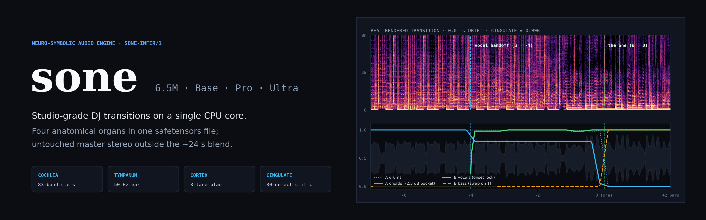

# Sone – Neuro-symbolic DJ transitions on one CPU core

[](./crates)
[](./MODEL_CARD.md)
[](./docs/MEMORY.md)
[](./paper/main.pdf)
[](./LICENSE)

**Sone** (named after Stevens' psychoacoustic *sone* unit of perceived loudness) is a unified family of neuro-symbolic DJ transition and stem separation models that run on a single CPU thread or WebAssembly worker with zero external ML runtime dependencies. Four anatomical organs inside one `model.safetensors` file perceive, separate, plan, and audit a ~24 s boundary window while studio master stereo streams untouched bit-for-bit everywhere else.

---

## Features

- **Untouched master splicing** — Separates and mixes stems strictly inside the ~24 s overlap `[u_0, u_1]`, splicing gain-matched studio masters via 23.2 ms raised-cosine seams (`~7.5×` less compute, zero codec coloration outside the blend).
- **Single-file 4-organ `.safetensors` (`sone-infer/1`)** — Packages **Cochlea** (`cochlea.*`), **Tympanum** (`tympanum.*`), **Cortex** (`cortex.*`), and **Cingulate** (`cingulate.*`) into one zero-copy IEEE-754 FP16 checkpoint loaded via `Sone::load`.
- **Phase-coherent Dual-Axis Cochlea** — `4096`-FFT (`10.77 Hz`/bin), `64`–`83` vocal-formant subbands, Dual-Axis Time+Band Transformer, bounded 4-stem complex masks, and exact Wiener mixture conservation (`< -148 dB`) distilled from `BS-RoFormer-1297` + `HTDemucs-ft`.
- **Vinyl-equivariant Tympanum + comb-grid** — `50 Hz` dilated TCN–BiGRU trained under exact turntable speed equivariance across 7 structural heads, locked to a spectral-flux comb grid with Newton drum-slope phase alignment (`<= 2.2 ms` beat drift).
- **Sharp-cut Cortex & 30-defect Cingulate** — Beat-synchronous Transformers with sixteenth-note vocal-onset handoff, pre-vocal bleed gating, post-drop unity stem lock, and Best-of-`6` counterfactual reranking in `< 140 ms` CPU.
- **Pure Rust & WebAssembly** — Tiled FP16-to-FP32 inference, key-locked transient-preserving stretch, Linkwitz-Riley EQ, tempo-synced vocal echo, and BS.1770-4 loudness normalization with no C, Python, or ONNX dependencies.

---

## Model family

| Tier | Checkpoint | Params | FP16 Size | Cochlea (`cochlea.*`) | Tympanum | Cortex / Cingulate | 1-Core CPU / Song |
|---|---|---:|---:|---|---|---|---:|
| **Sone-6.5M** | `sone-6.5M-f16.safetensors` | `6.52M` | `13.1 MB` | `4.52M` (`2048`-FFT, 42b, `0.13×` RT) | `305K` | `1.22M` / `475K` | `4.8%` (`8.6 s`) |
| **Sone-v2-Base** | `sone-v2-base-f16.safetensors` | `13.61M` | `27.4 MB` | `11.61M` (`4096`-FFT, 64b, `0.40×` RT) | `305K` | `1.22M` / `475K` | `11.9%` (`21.5 s`) |
| **Sone-Pro** | `sone-pro-f16.safetensors` | `26.37M` | `52.9 MB` | `20.07M` (`4096`-FFT, 64b, `0.95×` RT) | `1.47M` | `3.60M` / `1.23M` | `27.1%` (`48.8 s`) |
| **Sone-Ultra** | `sone-ultra-f16.safetensors` | `42.2M` | `84.6 MB` | `35.9M` (`4096`-FFT, 83b, `10B/160D`) | `1.47M` | `3.60M` / `1.23M` | Studio offline / multi-core |

---

## Quick start

```bash
git clone https://github.com/luka-loehr/sone.git
cd sone
cargo test --release --workspace
cargo build --release -p sone
```

Load all four organs from a single unified checkpoint in Rust:

```rust
use sone_infer::{Sone, WeightFile};

let sone = Sone::load(WeightFile::from_vec(std::fs::read("model.safetensors")?)?)?;
```

Reproduce the CUDA teacher distillation, training, evaluation, and LaTeX paper build:

```bash
python3 scripts/cuda/distill_modern_stems_cuda.py --out data/distilled_roformer
python3 scripts/cuda/train_cochlea_v2_cuda.py --size pro --out exports/pro
python3 scripts/cuda/train_beat_v4_cuda.py --train data/sim/train.jsonl.gz --val data/sim/val.jsonl.gz --out exports/beat_v4
make -C paper all
```

---

## Documentation

- [Preprint Paper (PDF)](./paper/main.pdf) and [Paper Build & Figure Generators](./scripts/paper) — LaTeX source, programmatic tables, figures, and banner generator
- [CUDA Training & Teacher Distillation](./scripts/cuda) and [End-to-End Evaluator](./scripts/eval/run_e2e_eval.py) — `BS-RoFormer-1297` + `HTDemucs-ft` cascade and GPU trainers
- [Model Card](./MODEL_CARD.md) — Parameter tables, hardware inventory, evaluation metrics, and limitations
- [Architecture](./docs/ARCHITECTURE.md) & [Organ Specs](./docs/ORGANS.md) — Boundary-spliced design and `sone-infer/1` wire format
- [DJ Transition Rules](./docs/RULES.md), [Renderer & DSP](./docs/RENDERER.md), and [Memory & WebAssembly Budget](./docs/MEMORY.md)

---

## License

Code is licensed under the Apache License 2.0; see [LICENSE](./LICENSE). Trained model weights inherit non-commercial research terms ([CC BY-NC-SA 4.0](./MODEL_CARD.md)) from MUSDB18-HQ.

---

## Support

Open an issue on [GitHub Issues](https://github.com/luka-loehr/sone/issues) or email [luka@lukaloehr.com](mailto:luka@lukaloehr.com).

---

Developed by [Luka Löhr](https://github.com/luka-loehr)
