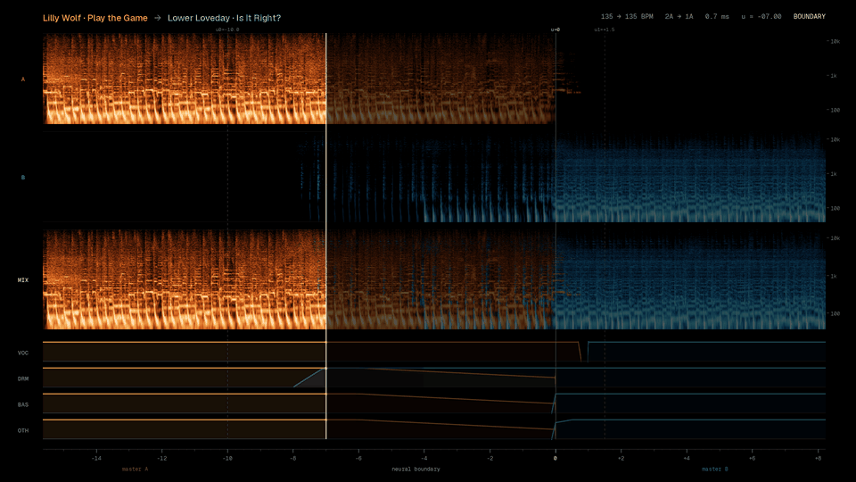
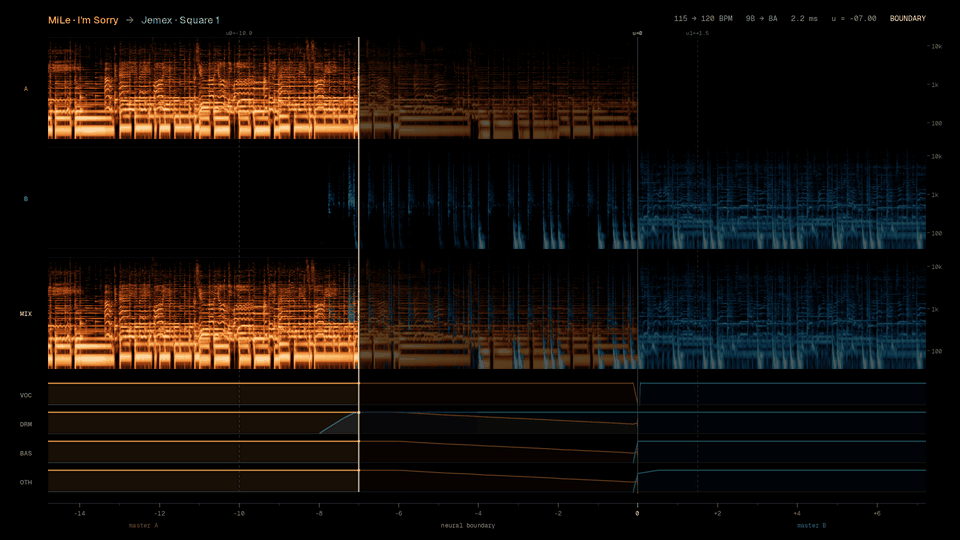
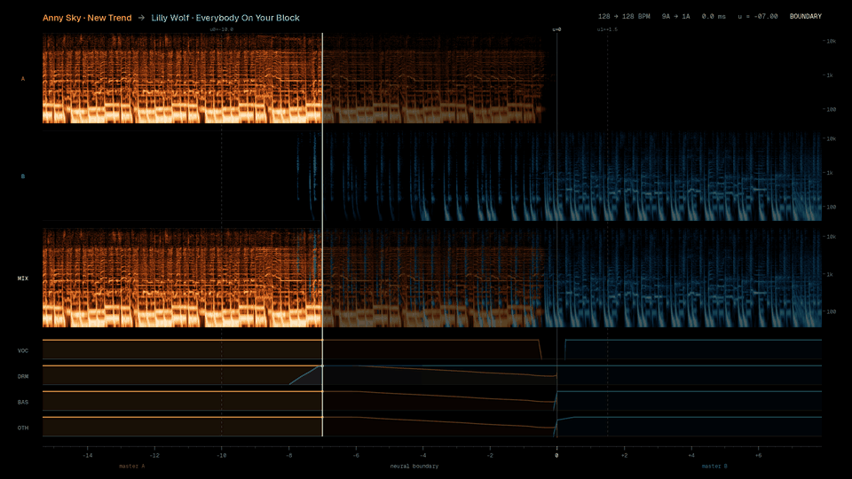

<p align="center"></p>

# Sone

**Sone** (named after Stevens' psychoacoustic *sone* unit of perceived loudness) is an open-source family of four-organ neuro-symbolic DJ transition and stem separation models (`6.5M` to `35.5M` parameters) written in pure Rust and WebAssembly with zero external ML runtime dependencies.

Instead of passing full tracks through a generative audio codec, Sone separates, analyses, plans, and audits only a ~24 s boundary window around each track handoff. Four compact neural organs packaged inside a single `model.safetensors` file predict phase-coherent stem masks, 50 Hz metrical structure, beat-synchronous stem fader trajectories, and 30-mode defect scores, while deterministic Rust DSP renders the blend and splices untouched studio master stereo bit-for-bit everywhere outside the transition.

**[Paper (PDF)](paper/main.pdf)** · **[Interactive Live Player](https://lukaloehr.com/sone/#demos)** · **[Blog Post](https://lukaloehr.com/blog/sone/)** · **[Weights (Releases)](https://github.com/luka-loehr/sone/releases/tag/v0.1.0)** · **[Model Card](MODEL_CARD.md)**

---

## QuickStart

Requires Rust (`1.85+`). Zero Python, C++, CUDA, ONNX, or LibTorch dependencies are needed at inference time.

```bash
# 1. Clone and build the release CLI
git clone https://github.com/luka-loehr/sone.git
cd sone
cargo build --release -p sone

# 2. Download a unified 4-organ FP16 checkpoint (choose 13 MB fast or 53 MB studio Pro)
curl -LO https://github.com/luka-loehr/sone/releases/download/v0.1.0/sone-pro-f16.safetensors

# 3. Render an end-to-end beat-locked DJ transition from two full-length 44.1 kHz WAV/FLAC songs
./target/release/sone transition song_a.wav song_b.wav \
  --model sone-pro-f16.safetensors \
  --out transition.wav

# Or separate any 44.1 kHz WAV/FLAC song into vocals, drums, bass, and other stems
./target/release/sone stems song_a.wav \
  --model sone-pro-f16.safetensors \
  --out stems/
```

> **Use full-length songs, not truncated preview clips:** Sone is trained to locate natural song endings (outro phrases, beat wind-downs, vocal exits) on Deck A and real intros or verse entries on Deck B so it can overlap them cleanly. Passing 30 s store snippets or 2 min preview clips cut mid-chorus removes the structural ending and forces fallback cuts. If your inputs are MP3/AAC or 48 kHz, convert to 44.1 kHz WAV first (`ffmpeg -i input.mp3 -ar 44100 song_a.wav`).

### Pre-trained Checkpoints (`v0.1.0`)

All four tiers use the same zero-copy `sone-infer/1` `.safetensors` format and load interchangeably via `Sone::load`:

| Tier | Checkpoint | Params | FP16 Size | 1-Core CPU / Mix | Amortized (180 s Song) | Download |
|---|---|---:|---:|---:|---:|---|
| **Sone-6.5M** | `sone-6.5M-f16.safetensors` | 6.52 M | 13.12 MB | 8.6 s | 4.8% | [Download](https://github.com/luka-loehr/sone/releases/download/v0.1.0/sone-6.5M-f16.safetensors) |
| **Sone-v2-Base** | `sone-v2-base-f16.safetensors` | 13.61 M | 27.36 MB | 21.5 s | 11.9% | [Download](https://github.com/luka-loehr/sone/releases/download/v0.1.0/sone-v2-base-f16.safetensors) |
| **Sone-Pro** | `sone-pro-f16.safetensors` | 26.37 M | 52.90 MB | 49.5 s | 27.5% | [Download](https://github.com/luka-loehr/sone/releases/download/v0.1.0/sone-pro-f16.safetensors) |
| **Sone-Ultra** | `sone-ultra-f16.safetensors` | 35.48 M | 71.12 MB | 65.5 s | 36.4% | [Download](https://github.com/luka-loehr/sone/releases/download/v0.1.0/sone-ultra-f16.safetensors) |

---

## Transition Demos

Three transitions rendered by the unmodified Sone pipeline on full-length Creative Commons vocal tracks ([CC BY-SA 3.0](https://creativecommons.org/licenses/by-sa/3.0/); full artist attribution in [assets/demos/CREDITS.md](assets/demos/CREDITS.md)). Each 60 fps visualization plots Deck A's isolated spectrum (copper), Deck B's tempo-locked spectrum (cyan), the dual-chrominance master output, and all four stem gain trajectories (`VOC`, `DRM`, `BAS`, `OTH`) across `master A`, the neural boundary `[u0, u1]`, and `master B`. Explore them interactively in the **[Live Browser Player](https://lukaloehr.com/sone/#demos)** or open the 1080p60 MP4 renders below:

<p align="center">
  <a href="assets/demos/play-the-game-into-is-it-right.mp4"></a><br>
  <strong><a href="https://www.jamendo.com/track/1093616">Lilly Wolf · Play the Game</a> → <a href="https://www.jamendo.com/track/1559614">Lower Loveday · Is It Right?</a></strong> · <code>135 → 135 BPM · 2A → 1A · 0.7 ms drift</code> · <a href="https://lukaloehr.com/sone/#demos">Interactive player ↗</a> · <a href="assets/demos/play-the-game-into-is-it-right.mp4">1080p60 MP4</a>
</p>

| **[MiLe · I'm Sorry](https://www.jamendo.com/track/1145459) → [Jemex · Square 1 (ft. Derrius Dean)](https://www.jamendo.com/track/135657)** | **[Anny Sky · New Trend](https://www.jamendo.com/track/1187965) → [Lilly Wolf · Everybody On Your Block](https://www.jamendo.com/track/1093615)** |
|---|---|
| [](assets/demos/im-sorry-into-square-1.mp4)<br>`115 → 120 BPM · 9B → 8A · 2.2 ms drift` · [Interactive player ↗](https://lukaloehr.com/sone/#demos) · [1080p60 MP4](assets/demos/im-sorry-into-square-1.mp4) | [](assets/demos/new-trend-into-everybody-on-your-block.mp4)<br>`128 → 128 BPM · 9A → 1A · 0.0 ms drift` · [Interactive player ↗](https://lukaloehr.com/sone/#demos) · [1080p60 MP4](assets/demos/new-trend-into-everybody-on-your-block.mp4) |

---

## Implementation Examples

### 1. Rust: Unified 4-Organ Inference (`sone-infer`)

Add `sone-infer = { path = "crates/sone-infer" }` (compiles to native CPU or `wasm32-unknown-unknown` with zero external runtime dependencies):

```rust
use sone_infer::{CochleaWorkspace, Sone, TympanumWorkspace, WeightFile};

fn main() -> anyhow::Result<()> {
    // Zero-copy load of all four organs (Cochlea, Tympanum, Cortex, Cingulate)
    let bytes = std::fs::read("sone-pro-f16.safetensors")?;
    let sone = Sone::load(WeightFile::from_vec(bytes)?)?;

    // 1. Separate 44.1 kHz stereo PCM into [vocals, drums, bass, other]
    //    Guaranteed exact mixture conservation: sum(stems) == input (< -148 dB)
    let left: Vec<f32> = vec![0.0; 44_100 * 12];
    let right: Vec<f32> = vec![0.0; 44_100 * 12];
    let hop = sone.cochlea.config.hop;
    let mut stems = vec![[Vec::new(), Vec::new()]; 4];
    sone.cochlea.separate(
        &mut CochleaWorkspace::default(),
        &left,
        &right,
        (8 * 44_100 / hop) * hop,
        (44_100 / hop) * hop,
        &mut stems,
    );

    // 2. Extract 50 Hz beats, downbeats, vocal activity, breaths, Camelot key & tuning
    let mono: Vec<f32> = left.iter().zip(&right).map(|(l, r)| 0.5 * (l + r)).collect();
    let sensor = sone.tympanum.analyze(&mut TympanumWorkspace::default(), &mono);
    println!(
        "Detected key: {} ({:+.1} cents), {} frames @ 50 Hz",
        sensor.key_name(),
        sensor.tuning_cents,
        sensor.frames.len()
    );
    Ok(())
}
```

### 2. Rust: Gapless Live Radio / Playlist Engine (`sone-live`)

`sone-live` runs without internal threads, timers, or filesystem calls. Your audio callback or server pulls stereo PCM blocks and receives sample-accurate JSON-serializable events (`plan`, `transition_started`, `the_one`, `transition_ended`, `stats`):

```rust
use sone_live::{Config, Live, Song, When};

// Initialize a streaming station with 30 s look-ahead at -14 LUFS
let mut station = Live::new(Config::default(), my_renderer, my_stretcher_factory);

// Start Deck A and queue Deck B for natural phrase-aligned outro handoff
station.start(Song { id: "track_a".into(), table: table_a, lufs: -11.2, audio: pcm_a })?;
station.queue(Song { id: "track_b".into(), table: table_b, lufs: -12.4, audio: pcm_b }, When::AtEnd)?;

// Pull 1024-frame stereo blocks from your audio thread or HTTP stream
let mut block = vec![[0.0f32; 2]; 1024];
let events = station.pull(&mut block)?;
for ev in events {
    println!("station event: {}", serde_json::to_string(&ev)?);
}
```

### 3. WebAssembly (`sone-wasm`)

Compile the compact C ABI module (`~3.1 MB`) for browsers, Cloudflare Workers, Deno, or Bun:

```bash
rustup target add wasm32-unknown-unknown
cargo build --release --target wasm32-unknown-unknown -p sone-wasm
# Output: target/wasm32-unknown-unknown/release/sone_wasm.wasm
```

```ts
const wasmBytes = await fetch("/sone_wasm.wasm").then((r) => r.arrayBuffer());
const { instance } = await WebAssembly.instantiate(wasmBytes);
const sone = instance.exports as {
  memory: WebAssembly.Memory;
  sone_alloc(len: number): number;
  sone_free(ptr: number, len: number): void;
  sone_song(ptr: number, len: number, lufs: number, frames: number): number;
  sone_plan(a: number, b: number, optPtr: number, optLen: number): number;
  sone_stems(song: number, stem: number, start: bigint, ptr: number, frames: number): number;
  sone_render(): number;
  sone_result_ptr(): number;
  sone_result_len(): number;
  sone_audio_ptr(): number;
  sone_audio_len(): number;
};

function writeUtf8(text: string): [number, number] {
  const bytes = new TextEncoder().encode(text);
  const ptr = sone.sone_alloc(bytes.length);
  new Uint8Array(sone.memory.buffer, ptr, bytes.length).set(bytes);
  return [ptr, bytes.length];
}

// Register two BeatTables and compute the transition plan + required 24 s stem windows
const [ptrA, lenA] = writeUtf8(JSON.stringify(beatTableA));
const [ptrB, lenB] = writeUtf8(JSON.stringify(beatTableB));
const handleA = sone.sone_song(ptrA, lenA, -14.0, totalFramesA);
const handleB = sone.sone_song(ptrB, lenB, -14.0, totalFramesB);
sone.sone_free(ptrA, lenA);
sone.sone_free(ptrB, lenB);

if (sone.sone_plan(handleA, handleB, 0, 0) === 0) {
  const planJson = new TextDecoder().decode(
    new Uint8Array(sone.memory.buffer, sone.sone_result_ptr(), sone.sone_result_len()),
  );
  console.log("Planned transition:", JSON.parse(planJson));
}
```

---

## Architecture & How It Works

```text
Deck A master ─┐
               ├─► boundary window (~24 s) ─► Cochlea  (4096-FFT, 64-band 4-stem Wiener separator)
Deck B master ─┘                           ─► Tympanum (50 Hz 7-head sensor + multi-octave comb grid)
                                                    │
                                                    ▼
                                                Cortex   (Beat Transformer: recipe, bar offsets, 8 stem lanes)
                                                    │
                                                    ▼
                                                Cingulate (30-defect counterfactual monitor, Best-of-6)
                                                    │
                                                    ▼
                    untouched A ──► cosine seam ──► DSP blend + Newton lock ──► cosine seam ──► untouched B
```

| Component | Design |
|---|---|
| **`Cochlea`** (`cochlea.*`) | 4096-FFT (10.77 Hz/bin), 64 vocal-formant subbands, Dual-Axis Time+Band Transformer (`6B/80D` Base, `8B/128D` Pro, `10B/160D` Net2Net Ultra), bounded 4-stem complex masks |
| **Mixture conservation** | Power-weighted complex Wiener projection + time-domain `other = mix - (vocals + drums + bass)`, exact to `< -148 dB` |
| **`Tympanum`** (`tympanum.*`) | 50 Hz HTK log-mel (`128` or `160` bins), dilated DWConv + BiGRU, 7 heads (beat, downbeat, voice, breath, 8-bar phrase, 24 keys, tuning cents) + spectral-flux comb grid |
| **`Cortex`** (`cortex.*`) | Pre-RMSNorm Beat Transformer on 209 tokens (`[global; A_80; B_128]`, 24 features/beat), predicting recipe, `(u_start, u_swap)`, and `80 x 8` stem gain curves |
| **`Cingulate`** (`cingulate.*`) | Conflict Transformer scoring acceptability `q in [0, 1]` and 30 DJ defect modes, trained with 50% vectorized 12-mode GPU counterfactual synthesis; reranks `K = 6` plans in 52 to 100 ms CPU |
| **DSP & splicing** | Pure-Rust key-locked transient-preserving stretch, closed-form Newton drum-slope alignment, Linkwitz-Riley EQ, tempo-synced vocal echo, BS.1770-4 LUFS, 23.2 ms raised-cosine master seams |

---

## Evaluation Summary

Held-out MUSDB18-HQ (`n = 12`, 60 s stereo) separation SDR (dB), vocal-to-instrumental bleed, and single-threaded Intel Xeon CPU real-time factor (RTF) against the offline GPU teacher (`BS-RoFormer-1297`):

| Model (`cochlea.*`) | Vocals ↑ | Drums ↑ | Bass ↑ | Other ↑ | Mean SDR ↑ | Vocal leak ↓ | 1-vCPU RTF |
|---|---:|---:|---:|---:|---:|---:|---:|
| `Cochlea v1` (4.52 M, 2048-FFT, 42b) | 3.57 | 3.50 | 2.75 | 1.33 | 2.79 | -6.3 dB | 0.13x |
| `Cochlea-v2-Base` (11.61 M, 4096-FFT, 64b) | 6.73 | 6.06 | 4.23 | 2.60 | 4.90 | -9.3 dB | 0.40x |
| `Cochlea-Pro` (20.07 M, Stage-1) | 7.84 | 6.76 | 4.41 | 3.19 | 5.55 | -10.8 dB | 0.96x |
| `Cochlea-Pro v2` (20.07 M, +RoFormer-1297) | **7.98** | 6.99 | **4.63** | **3.31** | **5.73** | **-10.9 dB** | 0.96x |
| `Cochlea-Ultra` (29.18 M, 10B Net2Net) | 7.95 | **7.03** | 4.57 | 3.30 | 5.71 | -10.9 dB | 1.30x |
| *Teacher: `BS-RoFormer-1297`* | *12.98* | *–* | *–* | *–* | *–* | *-21.4 dB* | *GPU offline* |

Held-out planning, conflict monitoring (`val.jsonl.gz`, `n = 5,932` in v4), and 50 Hz structural perception:

| Organ | Held-out metric | Value | 1-vCPU latency |
|---|---|---|---:|
| `Tympanum-Pro` (1.47 M, equiv.) | Beat F1 / Downbeat F1 / Voice Acc / Tuning MAE | 0.862 / 0.506 / 82.3% / 6.41 c | 0.0085x RT |
| `Cortex v4-Pro` (3.60 M, 8L/192D) | Recipe Acc / Bar MAE / 8-Lane MAE | 98.16% / **0.127 bars** / **0.0157** | 38.0 ms |
| `Cingulate v4-Pro` (1.23 M, 30 heads) | Unseen Acc / Owner Precision (`n = 152`) | 96.61% / **100.0%** (FP = 0) | 16.7 ms (100 ms Best-of-6) |
| End-to-end rendered mixes (`n = 10`) | Beat drift / Vocal-handoff 1 s floor lift | `<= 0.7 ms` (0.28 ms mean) / **+10.55 dB** | 8.6 s to 65.5 s / mix |

Known limitations (detailed in the [paper](paper/main.pdf) and [Model Card](MODEL_CARD.md)):

- Songs sung continuously to their final beat without an instrumental outro or breath gap receive a clean on-beat cut or minimal sneak rather than risking a double-vocal clash.
- Truncated preview clips cut mid-song lack real structural endings and cannot be overlapped like complete studio arrangements.
- Single-pass 6 s chunked CPU separation narrows the gap to offline GPU ensembles, though dense stereo pop vocal reverb tails remain harder than for `>100M` full-song GPU RoPE models.
- `Cortex` plans within a 4/4 bar grammar (`±6.8%` key-locked stretch, or `2:1` / `1:2` octave locks) and does not synthesize scratch routines or 3/4 meter blends.

---

## Training & Reproducibility

Verify the workspace tests, generate synthetic transition training data, or run native Rust Burn training / CUDA distillation:

```bash
# Run all workspace unit, parity, and mixture-conservation tests
cargo test --release --workspace

# Generate synthetic transition + 30-defect training examples (data/sim/)
cargo run --release -p sone -- simulate

# Native Rust training via Burn (wgpu or CPU ndarray)
cargo run --release -p sone-train -- cortex --config cookbooks/cortex.toml
cargo run --release -p sone-train -- cingulate --config cookbooks/cingulate.toml

# Two-stage CUDA teacher distillation (BS-RoFormer-1297 + HTDemucs-ft) & paper build
python3 scripts/cuda/distill_modern_stems_cuda.py --out data/distilled_roformer
python3 scripts/cuda/train_cochlea_v2_cuda.py --size pro --out exports/pro
python3 scripts/cuda/train_beat_v4_cuda.py --train data/sim/train.jsonl.gz --val data/sim/val.jsonl.gz --out exports/beat_v4
python3 scripts/eval/run_e2e_eval.py --exports exports/pro
make -C paper all
```

### Training Data Provenance

Zero audio recordings are stored in model weights or repository source code.

| Source | Licence | Role |
|---|---|---|
| [MUSDB18-HQ](https://sigsep.github.io/datasets/musdb.html) | CC BY-NC-SA 4.0 | `Cochlea` separation (138 train / 12 held-out test) & `Tympanum` stem labels |
| [MTG-Jamendo](https://mtg.github.io/mtg-jamendo-dataset/) & [Song Describer](https://github.com/ilaria-manco/song-describer-dataset) | Creative Commons | Ephemeral GPU distillation (`BS-RoFormer-1297` + `HTDemucs-ft`) & `Tympanum` labels |
| `sone-sim v4` + `data/owner/` | Apache-2.0 | `Cortex v4` & `Cingulate v4` beat-table planning and 30-defect critique |

---

## Repository Layout & Documentation

```text
crates/
  sone-core/       transition Spec, BeatTable, Event, Example, 30-class Issue enum
  sone-dsp/        key-locked stretch, Linkwitz-Riley EQ, echo, reverb, limiter, BS.1770-4 LUFS
  sone-beats/      neuro-symbolic multi-octave comb-grid beat/downbeat tracker
  sone-analysis/   streaming stem and metrical feature extractor (24-feature BeatTable)
  sone-plan/       metrical alignment, Camelot harmonic rules, vocal-onset lock, candidate specs
  sone-render/     deterministic phase-locked transition renderer with per-bar telemetry
  sone-infer/      zero-dependency FP16/FP32 .safetensors runtime (Sone::load, sone-infer/1)
  sone-live/       pull-driven streaming radio station engine (30 s look-ahead, master splicing)
  sone-wasm/       compact wasm32 C ABI for browser and edge worker execution
  sone-models/     Burn neural definitions and safetensors exporters for all four organs
  sone-sim/        synthetic transition corpus and structured DJ defect generator
  sone-train/      native Rust training, checkpoint export, and numerical parity CLI
  sone-cli/        unified `sone` binary (transition, stems, analyse, plan, render, mix, live, simulate)
cookbooks/         per-organ training configurations (cochlea, tympanum, cortex, cingulate)
scripts/           CUDA distillation/trainers, evaluation harness, programmatic paper figures/tables
paper/             LaTeX source and compiled preprint (main.pdf)
docs/              deep-dive engineering documentation
assets/            repository banner and Creative Commons demo videos
```

Deep-dive docs: [Architecture](docs/ARCHITECTURE.md) · [Organs & Wire Format](docs/ORGANS.md) · [Transition Rules](docs/RULES.md) · [Renderer Verification](docs/RENDERER.md) · [Memory & CPU Profile](docs/MEMORY.md) · [Dataset Inventory](docs/DATA.md)

---

## Open-Source Licensing

- **Source code, runtime, DSP, simulator, and standalone planner/critic weights (`sone-cortex-*`, `sone-cingulate-*`):** Released under the permissive **[Apache License 2.0](LICENSE)** (commercial and open-source use permitted).
- **Pre-trained 4-organ bundles (`sone-6.5M`, `sone-v2-base`, `sone-pro`, `sone-ultra`):** Released under **[CC BY-NC-SA 4.0](https://creativecommons.org/licenses/by-nc-sa/4.0/)** because `Cochlea` and `Tympanum` include supervision from [MUSDB18-HQ](https://sigsep.github.io/datasets/musdb.html) (consistent with `Demucs` and `Open-Unmix`). To produce weights for commercial deployment, run the Apache-2.0 training pipeline (`scripts/cuda/` or `sone-train`) exclusively on commercially cleared stem datasets.
- **Rendered demo videos (`assets/demos/`):** Released under **[CC BY-SA 3.0](https://creativecommons.org/licenses/by-sa/3.0/)**; see [assets/demos/CREDITS.md](assets/demos/CREDITS.md).

## Citation

```bibtex
@misc{loehr2026sone,
  title  = {Sone: Sub-Core CPU DJ Transitions via Phase-Coherent Tonotopic Separation, Equivariant Metrical Perception, and Cortical Planning},
  author = {L{\"o}hr, Luka},
  year   = {2026},
  url    = {https://github.com/luka-loehr/sone},
  note   = {Preprint}
}
```
